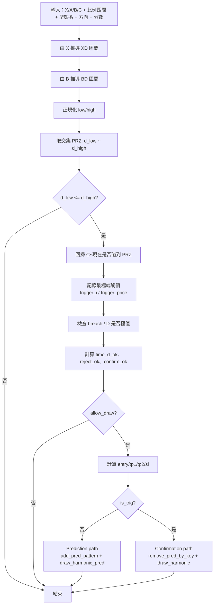

# Harmonic Pro+ 完整流程圖與對應資訊

> 對應檔案：`Harmonic/main.pine`

## 1) 全域主流程圖（完整執行路徑）

```mermaid
flowchart TD
    A[Script 初始化\nindicator + input + 全域陣列] --> B[每根 K 棒進入主流程]
    B --> C[cleanup_pred()\n清理過期/失效預測]
    C --> D[多尺度掃描\nrun_scanner(10..500, step=5)]

    D --> E{單一 len 掃描\nrun_scanner(len)}
    E --> F[ta.pivothigh/low 取樞紐]
    F --> G{是否形成 X-A-B-C\n且時間順序正確}
    G -- 否 --> D
    G -- 是 --> H[計算 XA/AB/BC/XC 與 XB/AC]
    H --> I{swing + trend 過濾}
    I -- 否 --> D
    I -- 是 --> J[計算品質分數\nscore = 0.55 ratio + 0.25 time + 0.20 alt]
    J --> K{符合任一型態?\nBat/AltBat/Butterfly/.../5-0}
    K -- 否 --> D
    K -- 是 --> L[target(...)]

    L --> M{XD 與 BD 是否有重疊 PRZ}
    M -- 否 --> D
    M -- 是 --> N[搜尋 C 到現在是否觸及 PRZ\n決定 is_trig]
    N --> O{is_trig?}

    O -- 否 --> P{time_d_ok && !time_expired}
    P -- 否 --> D
    P -- 是 --> Q[畫預測圖形/PRZ/預測 TP-SL\n並註冊 pred_* 物件]
    Q --> D

    O -- 是 --> R[confirm_ok 判斷\nrev 或 reject + 無 breach + D 極值]
    R --> S{confirm_ok?}
    S -- 否 --> T[可選：畫 no-confirm reason]
    T --> D
    S -- 是 --> U[刪除同 base_key 的預測物件]
    U --> V[畫確認型態 + TP/SL]
    V --> D
```

## 2) PRZ 判斷子流程（target 函式）



## 3) 流程節點對應資訊（函式/行號/核心資料）

| 流程節點 | 函式/區塊 | 行號 (main.pine) | 主要輸入 | 主要輸出/副作用 |
|---|---|---|---|---|
| 初始化參數群組 | `grp_scan/grp_strict/grp_draw/grp_style` | 14, 19, 34, 47 | 使用者 input | 掃描、濾網、繪圖、樣式設定 |
| 物件註冊陣列 | `drawn_keys`, `pred_*`, `fail_reason_*` | 77-89 | 無 | 管理去重、預測物件、失敗原因標籤 |
| 舊 key 修剪 | `trim_keys_if_needed()` | 92-98 | `drawn_keys` | 控制記憶體成長 |
| 分數工具 | `score_near`, `score_in_range` | 113-129 | 比例值與容差 | 0~100 比例品質分數 |
| 結構工具 | `score_time_sym`, `score_alternation` | 132-146 | AB/BC 時長與斜率 | 時間對稱分、交替分 |
| 反轉確認 | `reversal_ok_at()` | 177-187 | 觸發點附近 K 棒 | engulfing / pin / break 判斷 |
| 預測物件清理 | `cleanup_pred()` | 298-317 | `pred_keys`, `tB/tC` | 刪除失效預測線/框/標籤 |
| 核心 PRZ 引擎 | `target(...)` | 426-573 | XABC 結構 + 比例邊界 | 走預測或確認繪圖路徑 |
| 單尺度掃描 | `run_scanner(len)` | 575-750 | `len` + 價格序列 | 找到候選型態後呼叫 `target` |
| 主執行入口 | `cleanup_pred(); run_scanner(10..500)` | 760-860 | 當前 bar | 每 bar 全流程執行 |

## 4) 型態辨識對應資訊（run_scanner 內）

| 型態 | 條件摘要 | PRZ 比例摘要 | 行號 |
|---|---|---|---|
| Bat | `XB 0.382~0.5`, `AC 0.382~0.886` | `XD 0.886`, `BD 1.618~2.618` | 634-644 |
| Alt Bat | `XB ~= 0.382`, `AC 0.382~0.886` | `XD 1.13`, `BD 2.0~3.618` | 646-656 |
| Butterfly | `XB ~= 0.786`, `AC 0.382~0.886` | `XD 1.27~1.414`, `BD 1.618~2.24` | 658-668 |
| Crab | `XB 0.382~0.618`, `AC 0.382~0.886` | `XD 1.618`, `BD 2.618~3.618` | 670-680 |
| Deep Crab | `XB ~= 0.886`, `AC 0.382~0.886` | `XD 1.618`, `BD 2.0~3.618` | 682-692 |
| Gartley | `XB ~= 0.618`, `AC 0.382~0.886` | `XD 0.786`, `BD 1.13~1.618` | 694-704 |
| Shark_886 | `XB 0.382~0.618`, `AC 1.13~1.618` | `XD 0.886~1.13`, `BD 1.618~2.24` | 706-716 |
| Shark_113 | `XB 0.382~0.618`, `AC 1.13~1.618` | `XD 1.13`, `BD 1.618~2.24` | 718-727 |
| Cypher | `XB 0.382~0.618`, `AC 1.13~1.414` | `XD 0.786`, `BD 1.272~2.0` | 729-739 |
| 5-0 | `XB 1.13~1.618`, `AC 1.618~2.24` | `XD 0~3`, `BD ~= 0.5` | 741-750 |

## 5) 關鍵決策變數對應表（target 內）

| 變數 | 意義 | 產生位置 | 對流程影響 |
|---|---|---|---|
| `is_trig` | 是否已有 D 觸發（PRZ 被觸及） | 456-476 | 決定走預測或確認路徑 |
| `time_d_ok` | D 時間對稱是否通過 | 503-507 | 預測 path 可否畫出 |
| `time_expired` | D 是否逾時 | 509 | 逾時即不允許預測 |
| `prz_breach` | 是否跌破/突破 PRZ 邊界 | 481-497 | 影響確認有效性 |
| `d_is_extreme` | 觸發點是否為區間極值 | 480-489 | 影響確認有效性 |
| `reject_ok` | 是否達到 ATR 拒絕位移 | 511-513 | `confirm_on_reject` 時可替代反轉形態 |
| `confirm_ok` | 最終確認通過 | 514 | true 才畫 confirmed pattern |
| `allow_draw` | 最終可繪製 gate | 533 | 同時管控 predicted/confirmed |

## 6) 預測與確認輸出物件對應

| 路徑 | 繪圖函式 | 物件類型 |
|---|---|---|
| Prediction | `draw_harmonic_pred`, `draw_trade_levels_pred` | `line`, `label`, `box`（帶 key 註冊） |
| Confirmed | `draw_harmonic`, `draw_trade_levels` | `line`, `label`（最終版） |
| 清理 | `delete_pred_objects`, `remove_pred_by_key`, `cleanup_pred` | 刪除對應 key 的舊物件 |

## 7) 分數公式對應

```text
score = 0.55 * s_ratio + 0.25 * s_time + 0.20 * s_alt
條件：score >= min_score 才送入 target(...) 進一步 PRZ 判斷
```

對應位置：`run_scanner(len)` 內各型態分支（約 640-750 行）。
